<div align="center">

<h1>Island</h1>

<b>A cozy, sticker-style desktop shell for Hyprland, built with Quickshell.</b><br>
The control center is a 3D phone, the bar is made of candy pills, and the lock screen and login screen share one design.

<br><br>

[Showcase](#showcase) &nbsp;|&nbsp; [Features](#features) &nbsp;|&nbsp; [Settings phone](#settings) &nbsp;|&nbsp; [Requirements](#requirements) &nbsp;|&nbsp; [Installation](#installation) &nbsp;|&nbsp; [Keybinds](#keybinds) &nbsp;|&nbsp; [Troubleshooting](#troubleshooting)

<br>

<div align="left">

> ⚠️ **This is a personal project.** Island is made for my own laptop (ASUS ROG Zephyrus G14 on CachyOS, an external
> 1440p HDR screen + the laptop screen). It works for me every day, but expect rough edges on other machines.

</div>

<br>

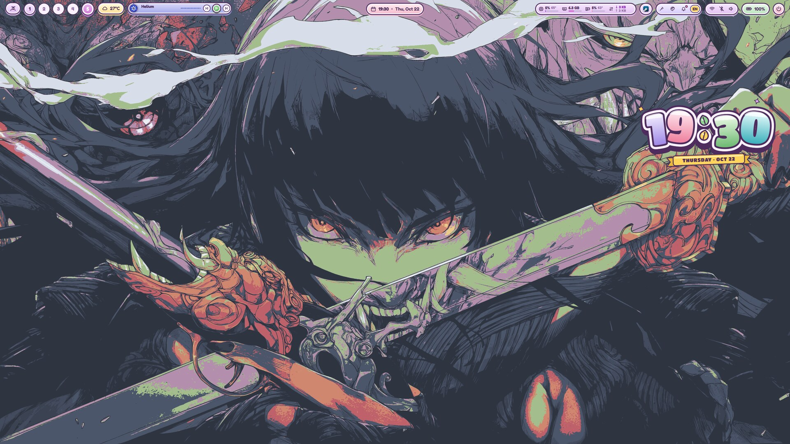

<sub>The desktop: bar with workspaces, weather, music, clock, system stats, tray, quick toggles and battery. The big sticker clock sits on the wallpaper.</sub>

</div>

---

<h2 id="showcase">✿ Showcase</h2>

<div align="center">
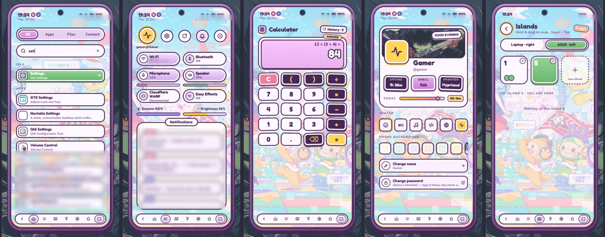
<sub>The phone (<kbd>Super</kbd> + <kbd>Space</kbd>): search · quick panel · calculator · profile · islands (workspaces)</sub>
</div>

<br>

<table>
<tr>
<td width="50%" valign="top">
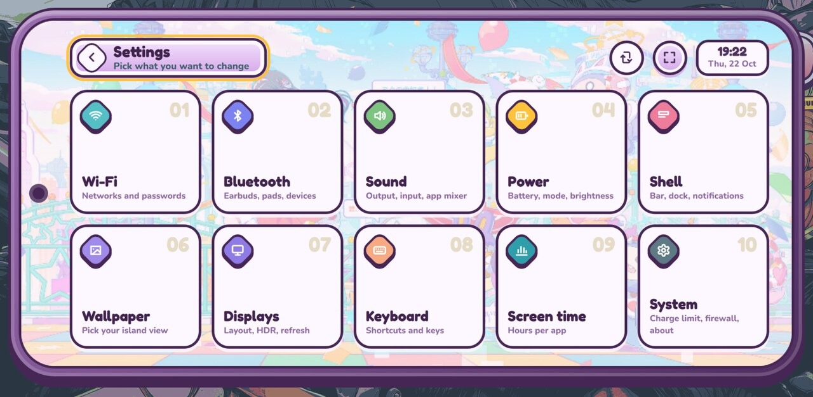
<br><b>Settings: turn the phone sideways</b><br>
All settings live in the phone. Turn it (<kbd>Ctrl</kbd> + <kbd>S</kbd>) and it becomes a wide tablet with 15 pages: Wi-Fi, Bluetooth, Sound, Power, Shell, Wallpaper, Displays, Keyboard, Screen time, System and more.
</td>
<td width="50%" valign="top">
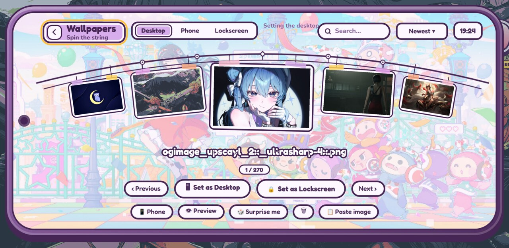
<br><b>Wallpapers on a string</b><br>
Pictures hang on a washing line. Press 👁 <b>Preview</b> (or <kbd>Space</kbd>) and the phone shrinks into the corner while the desktop follows the picture you pick. Set it for the desktop, the phone or the lock screen.
</td>
</tr>
<tr>
<td width="50%" valign="top">
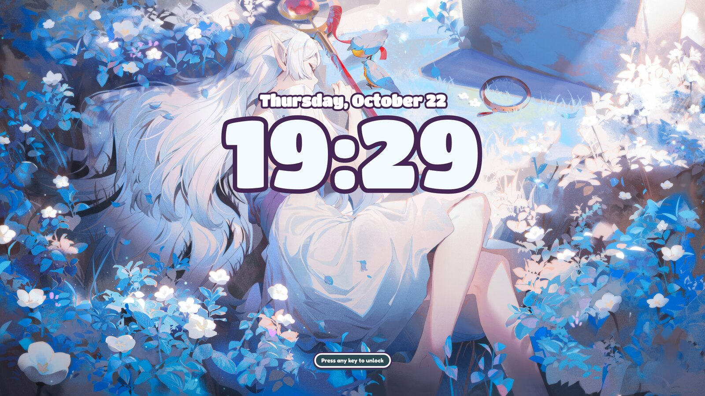
<br><b>Lock screen</b><br>
Your lock wallpaper, the date and a big sticker clock. Press any key…
</td>
<td width="50%" valign="top">
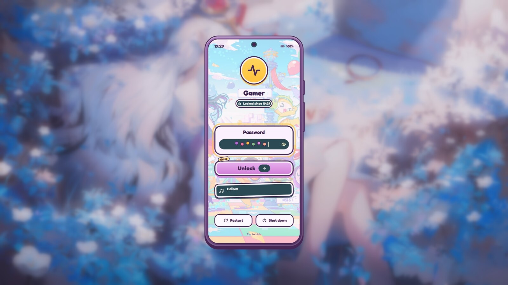
<br><b>…and the phone slides up</b><br>
Avatar, "Locked since", password dots, Unlock, the song that is playing, Restart / Shut down. The background blurs.
</td>
</tr>
<tr>
<td width="50%" valign="top">
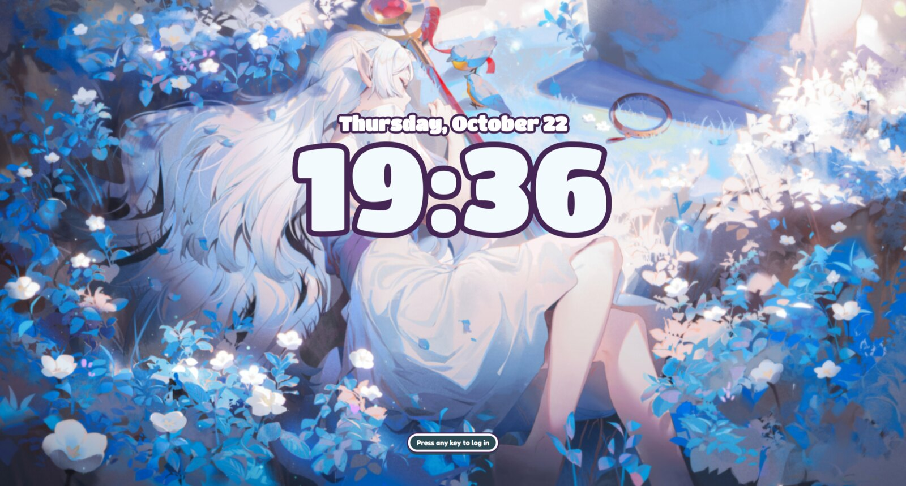
<br><b>Login screen (island-greeter)</b><br>
The same design greets you at boot: greetd runs a small Hyprland with Island's lock screen as the login. "Press any key to log in"…
</td>
<td width="50%" valign="top">
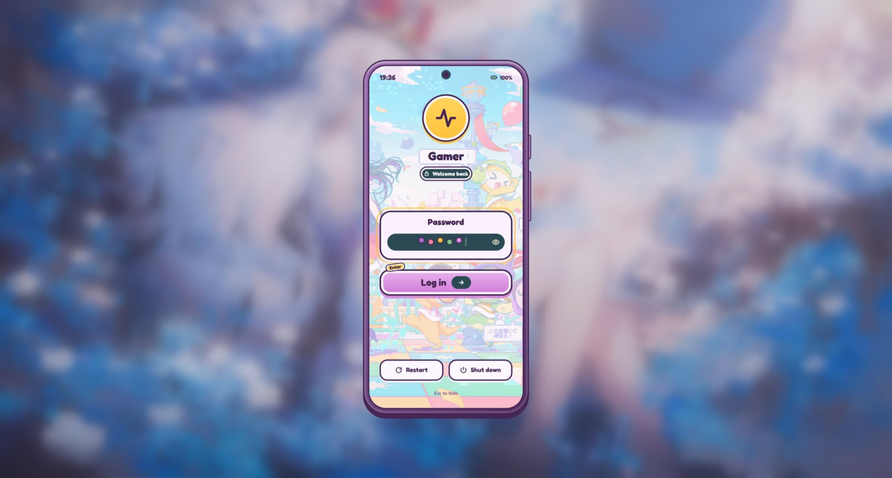
<br><b>…Welcome back</b><br>
"Welcome back", a user picker when there is more than one user, Log in, Restart / Shut down. After login the phone is pulled down and an iris in the wallpaper colour opens your desktop, with no black flash in between.
</td>
</tr>
</table>

---

<h2 id="features">✿ Features</h2>

### The bar

Every pill opens a card right under it. All cards share one look: a header box with halftone dots, small tilts and sticker shadows.

<table>
<tr>
<td width="33%" valign="top" align="center">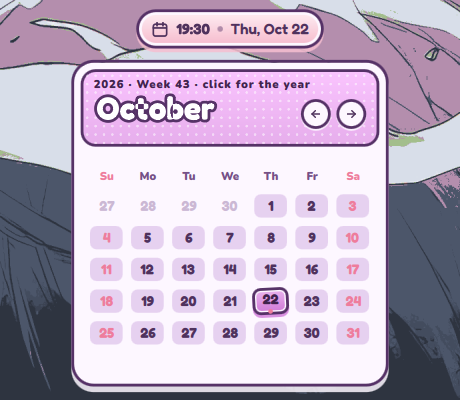<br><b>Calendar + notes</b><br><sub>Month view → click a day → pick an hour and add a note (text or a pasted picture). Reminders pop up on time and wait during Do not disturb.</sub></td>
<td width="33%" valign="top" align="center">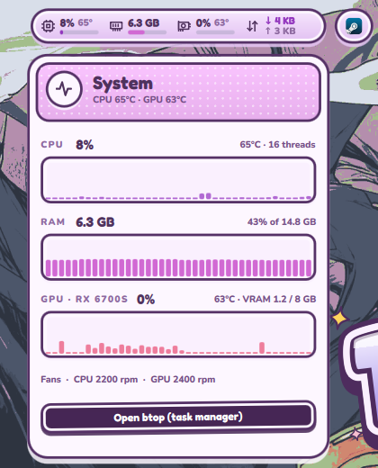<br><b>System</b><br><sub>Live CPU, RAM and GPU graphs with temperatures, VRAM and fan speeds. One click opens btop.</sub></td>
<td width="33%" valign="top" align="center">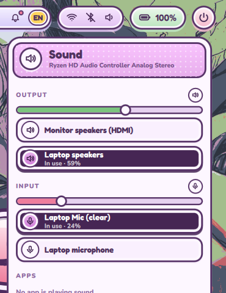<br><b>Sound</b><br><sub>Output and input volume, pick the speaker or mic, and a mixer for every app playing sound.</sub></td>
</tr>
<tr>
<td valign="top" align="center">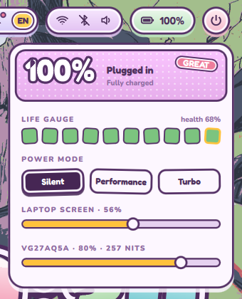<br><b>Battery + power</b><br><sub>Charge, health "life gauge", ASUS power mode (Silent / Performance / Turbo) and brightness for every screen (laptop backlight, DDC/CI or HDR nits).</sub></td>
<td valign="top" align="center">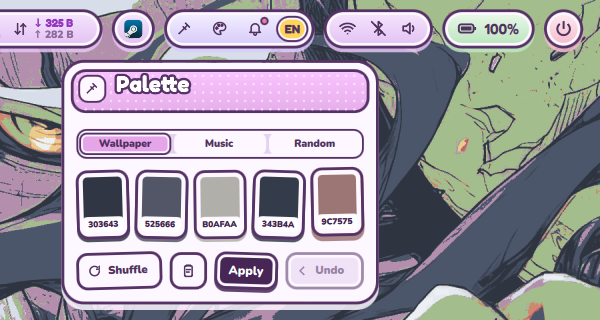<br><b>Palette</b><br><sub>Take colours from the wallpaper, the album cover or at random, shuffle them, apply them to the whole shell, and undo.</sub></td>
<td valign="top" align="center">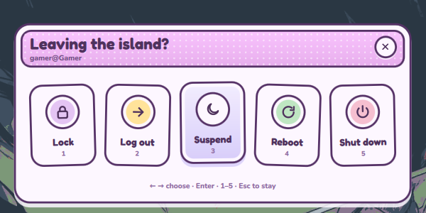<br><b>Power menu</b><br><sub><kbd>Super</kbd> + <kbd>Esc</kbd>: Lock, Log out, Suspend, Reboot, Shut down. Arrow keys, Enter, or 1–5.</sub></td>
</tr>
</table>

Also in the bar: workspaces per screen, weather, a music pill (cover, visualizer, controls), a colour picker,
notifications with Quiet mode, an EN / VI input switch, Wi-Fi / Bluetooth / sound icons and battery.

### The phone

<table>
<tr>
<td width="20%" valign="top" align="center">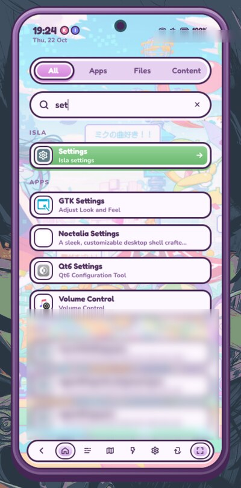<br><b>Search</b><br><sub>Apps, Island pages, files, text inside files, maths and Google. Tabs: All / Apps / Files / Content.</sub></td>
<td width="20%" valign="top" align="center">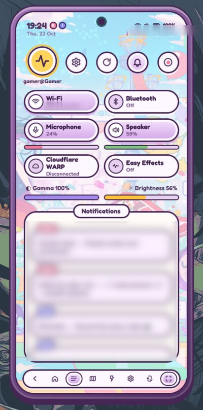<br><b>Quick panel</b><br><sub>Wi-Fi, Bluetooth, mic, speaker, Cloudflare WARP, Easy Effects, gamma, brightness, record button and notifications.</sub></td>
<td width="20%" valign="top" align="center">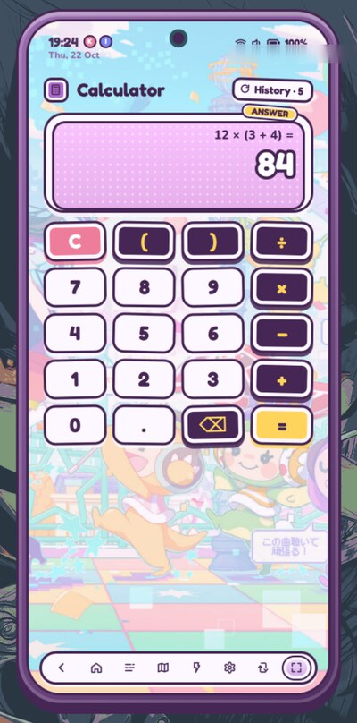<br><b>Calculator</b><br><sub>Brackets, history, <code>2(3)</code> = 2×3, "= again" repeats the last step, ÷ 0 → ERROR.</sub></td>
<td width="20%" valign="top" align="center">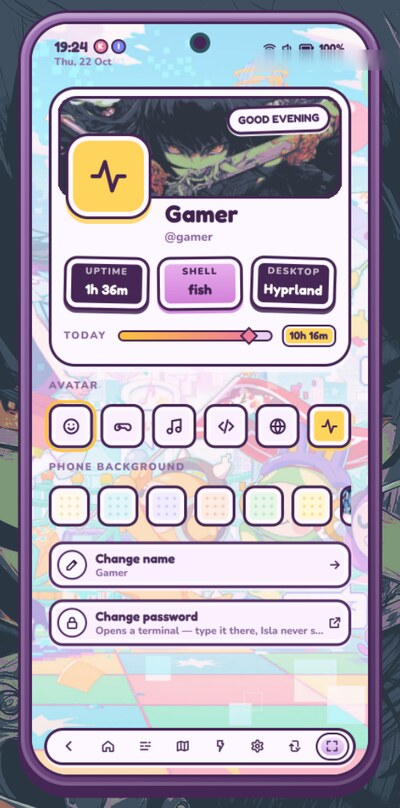<br><b>Profile</b><br><sub>Uptime, shell, desktop, today's screen time, avatar, phone background, name and password.</sub></td>
<td width="20%" valign="top" align="center">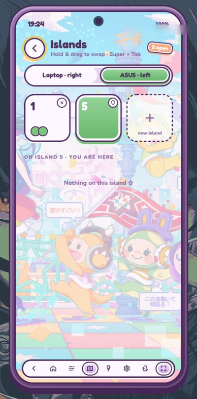<br><b>Islands</b><br><sub>Workspaces of each screen. Drag to swap, close with a confirm, add a new island.</sub></td>
</tr>
</table>

- **Upright or sideways:** <kbd>Ctrl</kbd> + <kbd>S</kbd> turns it. Both shapes have their own layout for every page.
- **Small or big:** <kbd>Ctrl</kbd> + <kbd>F</kbd>. **Height:** Low / Middle / High.
- **Overlay or window:** <kbd>Super</kbd> + <kbd>Z</kbd>. The same phone glides from the overlay into a normal window and back.
- **Keyboard:** <kbd>Ctrl</kbd> + <kbd>1…5</kbd> jump · <kbd>Ctrl</kbd> + <kbd>←</kbd>/<kbd>→</kbd> pages · <kbd>Alt</kbd> + <kbd>←</kbd> back · <kbd>F1</kbd> help · <kbd>Esc</kbd> close.
- **Lazy:** the phone is built the first time you open it and removed 3 minutes after you close it, to save memory.

### Around the desktop

| Feature | What it does |
|---|---|
| **Dock** | Auto-hide dock with live window previews and running dots |
| **Notifications** | Up to 3 bubbles with a queue, history in the bell card, Do not disturb, quiet while gaming |
| **Snip editor** | <kbd>Super</kbd> + <kbd>S</kbd> / <kbd>Print</kbd>: freeze the screens, pick an area, draw, crop, resize. Enter = save + copy, Esc = copy only |
| **Record** | Record button drives OBS (through obs-websocket) with Island's own screen picker, also used by Discord and browsers |
| **Clipboard** | History with pins and auto-clean after N days |
| **Lock + login** | One `LockScreen.qml` for both. Circle "iris" transition with an icon; the colour can follow the wallpaper |
| **Pop-ups** | Polkit password, keyring password and Bluetooth pairing dialogs, all in Island's style |
| **Game mode** | Animations off, phone light mode, visualizer paused, slower polling |
| **Find my mouse** | Double-tap <kbd>Ctrl</kbd>: rings around the cursor |
| **Apps look** | Kvantum "Island" theme, Island KDE colours, qt6ct colours, GTK CSS and an Island folder icon set, so apps match |

---

<h2 id="settings">✿ The settings phone</h2>

<table>
<tr>
<td width="50%" valign="top">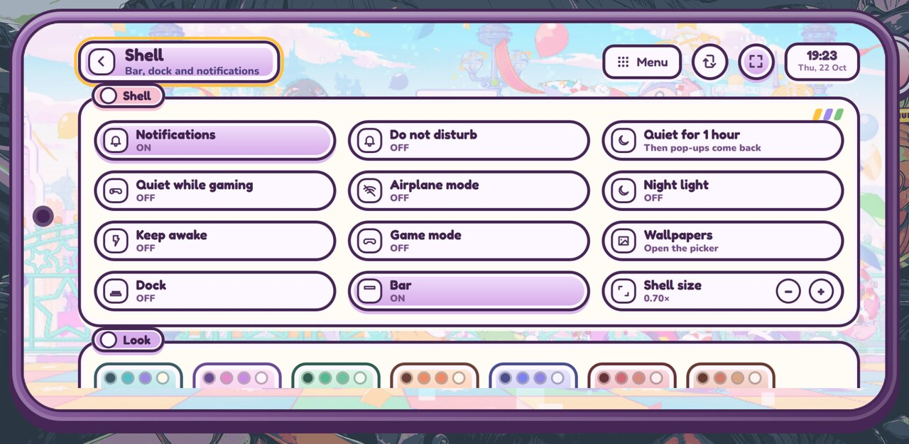<br><b>Shell</b>: notifications, Do not disturb, quiet while gaming, keep awake, game mode, night light, dock, bar, shell size, and the <b>Look</b> section: colour palettes, hue slider, box styles (candy / ring / pop / soft / flat / glass), dark mode.</td>
<td width="50%" valign="top">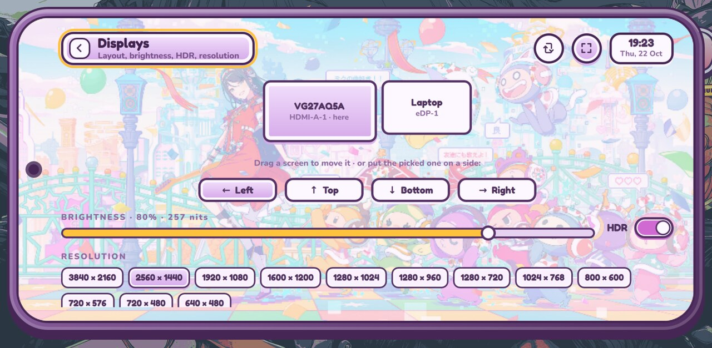<br><b>Displays</b>: drag the screens on a map, brightness, HDR switch, resolution, refresh rate and scale. Changes are tried live and only saved when you press Keep.</td>
</tr>
<tr>
<td valign="top">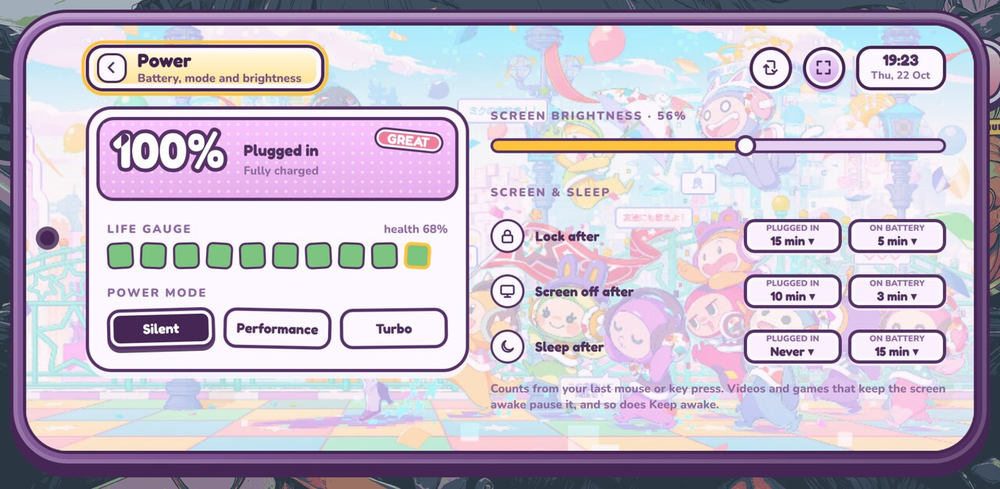<br><b>Power</b>: battery, life gauge, power mode, brightness, and lock / screen-off / sleep timers for plugged-in and on-battery.</td>
<td valign="top">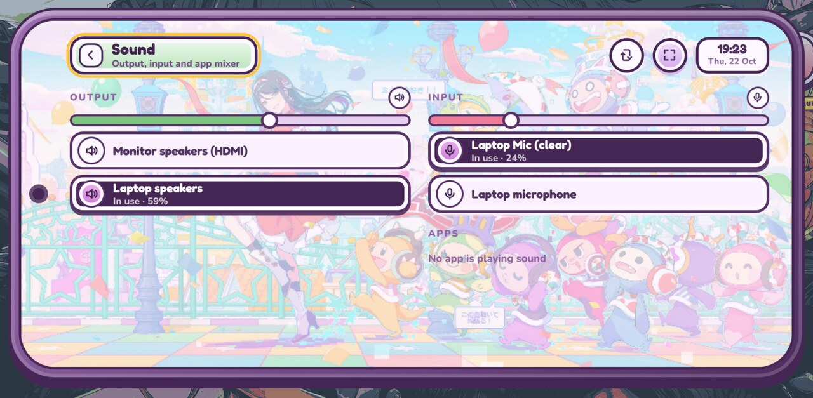<br><b>Sound</b>: outputs, inputs and the per-app mixer.</td>
</tr>
<tr>
<td valign="top">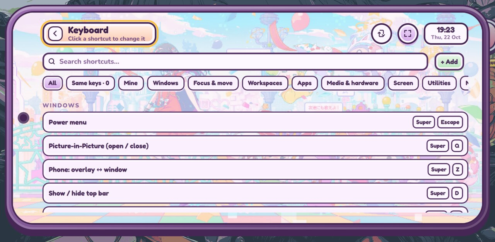<br><b>Keyboard</b>: every Hyprland shortcut in groups, search, "same keys" check, click a shortcut and press new keys. Writes the Lua binds and rolls back if Hyprland refuses them.</td>
<td valign="top">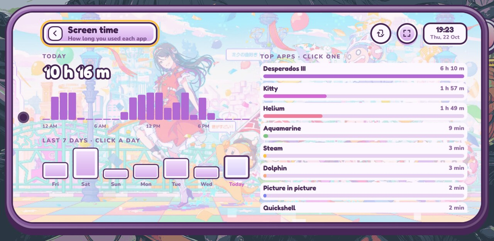<br><b>Screen time</b>: hours per day, top apps, last 7 days. Click a day or an app for details.</td>
</tr>
<tr>
<td valign="top">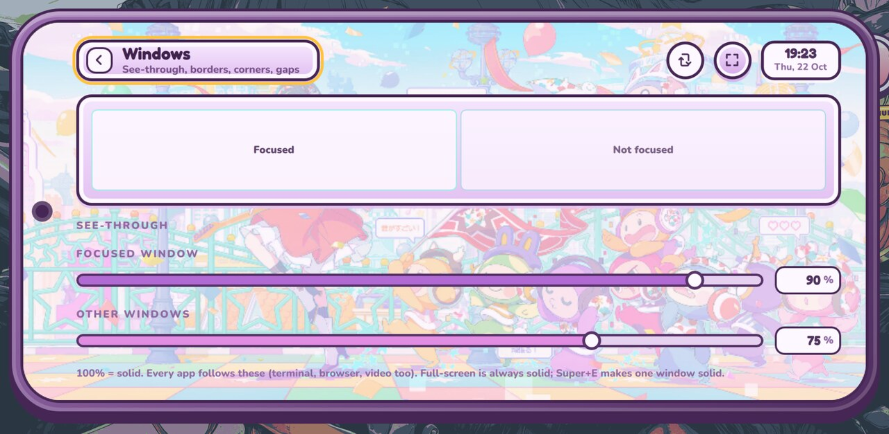<br><b>Windows</b>: see-through for focused / other windows, borders and colours, corner radius, gaps.</td>
<td valign="top">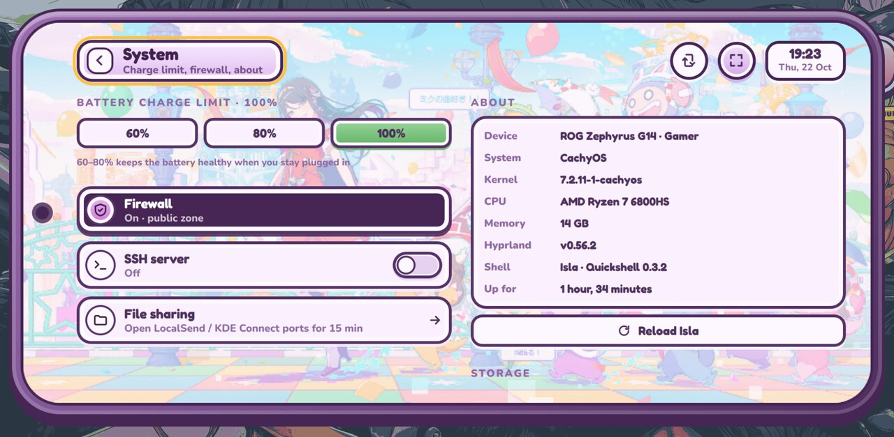<br><b>System</b>: battery charge limit, firewall, SSH server, file sharing, "about this PC", reload Island, storage and a manual update check.</td>
</tr>
<tr>
<td valign="top">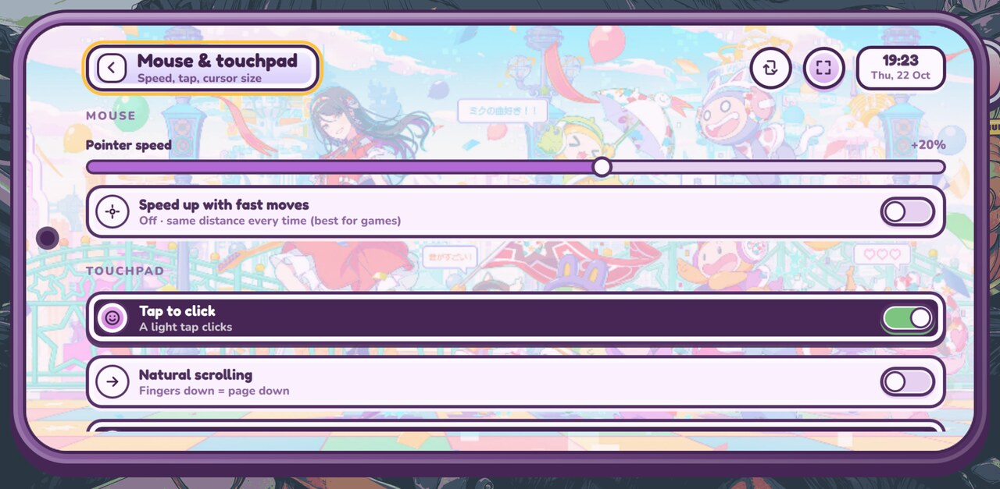<br><b>Mouse & touchpad</b>: pointer speed, acceleration, tap to click, natural scrolling, disable while typing.</td>
<td valign="top">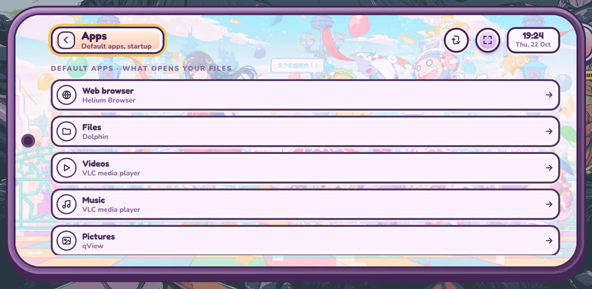<br><b>Apps</b>: default browser, files, video, music and picture apps, and startup apps.</td>
</tr>
<tr>
<td valign="top">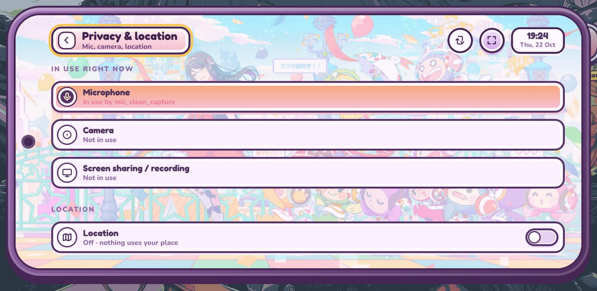<br><b>Privacy & location</b>: which app uses the mic, camera or screen right now, and location for the weather.</td>
<td valign="top">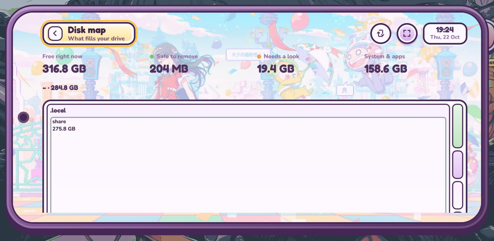<br><b>Disk map</b>: what fills your drive, safe-to-remove caches, and folders that need a look.</td>
</tr>
</table>

Also: **Wi-Fi** (networks, passwords, per-network DNS / IP), **Bluetooth** (pair, trust, connect), **Time & language**
(time zone, 24-hour clock, keyboard layouts) and **Wallpaper**.

---

<h2 id="requirements">✿ Requirements</h2>

| Need | Notes |
|---|---|
| **Arch-based distro** | Made and tested on CachyOS |
| **Hyprland 0.56+** with the **Lua** config | Island talks to Hyprland with `hyprctl dispatch 'hl.dsp…'` (Lua dispatchers) |
| **Quickshell** 0.3+ | Started as `qs -c island` |
| **Python 3** | Small helpers in `island/tools/` (no extra modules needed, except `dbus-python` for the keyring prompter) |

<details>
<summary><b>Packages</b></summary>
<br>

| For | Packages |
|---|---|
| Core | `quickshell` `hyprland` `qt6-declarative` `qt6-multimedia` `python` `curl` `jq` `libnotify` |
| Network / Bluetooth / sound | `networkmanager` `bluez` `bluez-utils` `pipewire` `wireplumber` `pipewire-pulse` |
| Clipboard, search | `wl-clipboard` `cliphist` `fd` `ripgrep` |
| Music | `cava` `playerctl` |
| Brightness, power | `brightnessctl` `ddcutil` (external screens) · `asusctl` (ASUS laptops, optional) |
| Snip, colour picker | `grim` `slurp` `hyprpicker` `imagemagick` |
| Record | `obs-studio` (obs-websocket on) |
| Look of other apps | `kvantum` `qt6ct` |
| Apps the buttons open | `kitty` `btop` `dolphin` (change them in Settings → Apps) |

</details>

<details>
<summary><b>Fonts</b></summary>
<br>

Fredoka, Nunito and Titan One are inside `island/fonts/` (SIL Open Font License). Island loads them by itself; you don't install anything.

</details>

---

<h2 id="installation">✿ Installation</h2>

### 1. Install

```bash
git clone https://github.com/minhtriet199/Cachy-OS-Hyprland-Island.git
cd Cachy-OS-Hyprland-Island
./install.sh
```

`install.sh` does not use `sudo`. It:

1. prints the `pacman` command for the packages (run it yourself),
2. copies the shell to `~/.config/quickshell/island` (an old copy is kept as `island.bak-<time>`),
3. copies the extras: Kvantum theme, Island icon set, KDE + qt6ct colours and the default wallpaper.

```
island/      the shell (QML) + tools/ (Python / shell helpers)
extras/    kvantum, icons, color-schemes, qt6ct, wallpapers
```

### 2. Start it

```bash
qs -c island
```

To start it with Hyprland, add this to your Lua config:

```lua
hl.on("hyprland.start", function () hl.exec_cmd("env MALLOC_ARENA_MAX=2 qs -c island") end)
```

(`MALLOC_ARENA_MAX=2` keeps Island at about 470 MB instead of about 850 MB.)

### 3. The full desktop (optional)

Some settings pages drive scripts from my Hyprland dotfiles: displays (`screenctl.py`), keyboard shortcuts
(`keybinds.py`), window look (`lookctl.py`), mouse (`inputctl.py`) and the snip tool (`snip.sh`). They are in
**[cachy_hyprland_dotfile](https://github.com/minhtriet199/cachy_hyprland_dotfile)** together with the Hyprland config,
the keybinds below and the **island-greeter** login screen. Without them those pages show what they can and skip the rest.

### Updating

`git pull` and run `./install.sh` again. Your settings live in `~/.local/state/island/prefs.json`, so they are kept.

### Talk to it from a terminal

```bash
qs -c island ipc call island phone home        # open a page: home quick islands profile calc settings wallpapers settingsDisplays …
qs -c island ipc call island close             # close the phone
qs -c island ipc call island drop calendar     # open a bar card: calendar music sys sound battery palette notifs weather wifi bt
qs -c island ipc call island rotate            # turn the phone
qs -c island ipc call island phonemode         # phone as overlay ↔ window
qs -c island ipc call island lock              # lock (locktest = 30 s test that unlocks by itself)
qs -c island ipc call island palette random    # palette: wallpaper | music | random | shuffle | apply | undo
qs -c island ipc call island gamemode          # game mode on / off
```

---

<h2 id="keybinds">✿ Keybinds</h2>

These come with my dotfiles (`~/.config/hypr/keybinds.json`). Change any of them in **Settings → Keyboard** (<kbd>Super</kbd> + <kbd>K</kbd>).

| Keys | Action |
|---|---|
| <kbd>Super</kbd> + <kbd>Space</kbd> | Phone (app launcher + search) |
| <kbd>Super</kbd> + <kbd>Tab</kbd> | Islands (workspaces) |
| <kbd>Super</kbd> + <kbd>Z</kbd> | Phone: overlay ↔ window |
| <kbd>Super</kbd> + <kbd>K</kbd> | Keyboard shortcuts page |
| <kbd>Super</kbd> + <kbd>B</kbd> | Bluetooth |
| <kbd>Super</kbd> + <kbd>V</kbd> | Clipboard history |
| <kbd>Super</kbd> + <kbd>Shift</kbd> + <kbd>W</kbd> | Wallpaper picker |
| <kbd>Super</kbd> + <kbd>D</kbd> | Show / hide the bar |
| <kbd>Super</kbd> + <kbd>Esc</kbd> | Power menu |
| <kbd>Super</kbd> + <kbd>S</kbd> / <kbd>Print</kbd> | Snip (region) |
| <kbd>Super</kbd> + <kbd>P</kbd> | Colour picker |
| <kbd>Super</kbd> + <kbd>C</kbd> | Play / pause |
| <kbd>Super</kbd> + <kbd>I</kbd> | ASUS mode: Silent → Performance → Turbo |
| <kbd>Super</kbd> + <kbd>Q</kbd> | Picture-in-picture open / close |
| <kbd>Super</kbd> + <kbd>T</kbd> / <kbd>Super</kbd> + <kbd>Return</kbd> | Terminal |
| <kbd>Super</kbd> + <kbd>W</kbd> | Close window |
| <kbd>Super</kbd> + <kbd>A</kbd> | Floating on / off |
| <kbd>Super</kbd> + <kbd>F</kbd> | Fullscreen |
| <kbd>Super</kbd> + <kbd>1…9</kbd> | Workspace N on the screen under the mouse |
| <kbd>Ctrl</kbd> + <kbd>Tab</kbd> | Jump to the other screen |
| <kbd>Ctrl</kbd> + <kbd>Shift</kbd> + <kbd>Esc</kbd> | Task manager (btop) |
| <kbd>Ctrl</kbd> twice | Find my mouse |

Inside the phone: <kbd>Ctrl</kbd> + <kbd>S</kbd> turn · <kbd>Ctrl</kbd> + <kbd>F</kbd> big / small · <kbd>Ctrl</kbd> + <kbd>1…5</kbd> jump · <kbd>F1</kbd> help · <kbd>Esc</kbd> close.

---

<h2 id="troubleshooting">✿ Troubleshooting</h2>

| Problem | Try |
|---|---|
| Island doesn't start / a page is empty | `qs -c island log` shows the error. Parts like the phone and the snip editor only load when opened, so open them once after a change |
| Two bars, or "Not ready" | Two copies are running: `pgrep -ax qs`, kill the newer one |
| Memory keeps growing after edits | Hot reload leaks. Restart fresh: `qs -c island kill; sleep 1; hyprctl eval 'hl.exec_cmd("env MALLOC_ARENA_MAX=2 qs -c island")'` |
| Changes to `prefs.json` don't show | Island doesn't watch the file. Change it from the phone, or restart Island |
| Keybinds don't work | `hyprctl configerrors`. Hyprland 0.56+ with the Lua config is needed |
| Screen share / record picker never opens | `systemctl --user restart xdg-desktop-portal-hyprland xdg-desktop-portal`, then restart OBS |

---

<h2 id="credits">✿ Credits</h2>

- **[Quickshell](https://quickshell.org)** and **[Hyprland](https://hyprland.org)**, which Island runs on.
- *Animal Crossing: New Horizons*: the inspiration for the phone, the island theme and the iris transition. Island is a fan-made look, not affiliated with Nintendo.
- Fonts: Fredoka, Nunito, Titan One (SIL Open Font License).
- Weather from [wttr.in](https://wttr.in).
- Wallpapers shown in the screenshots belong to their original artists.
